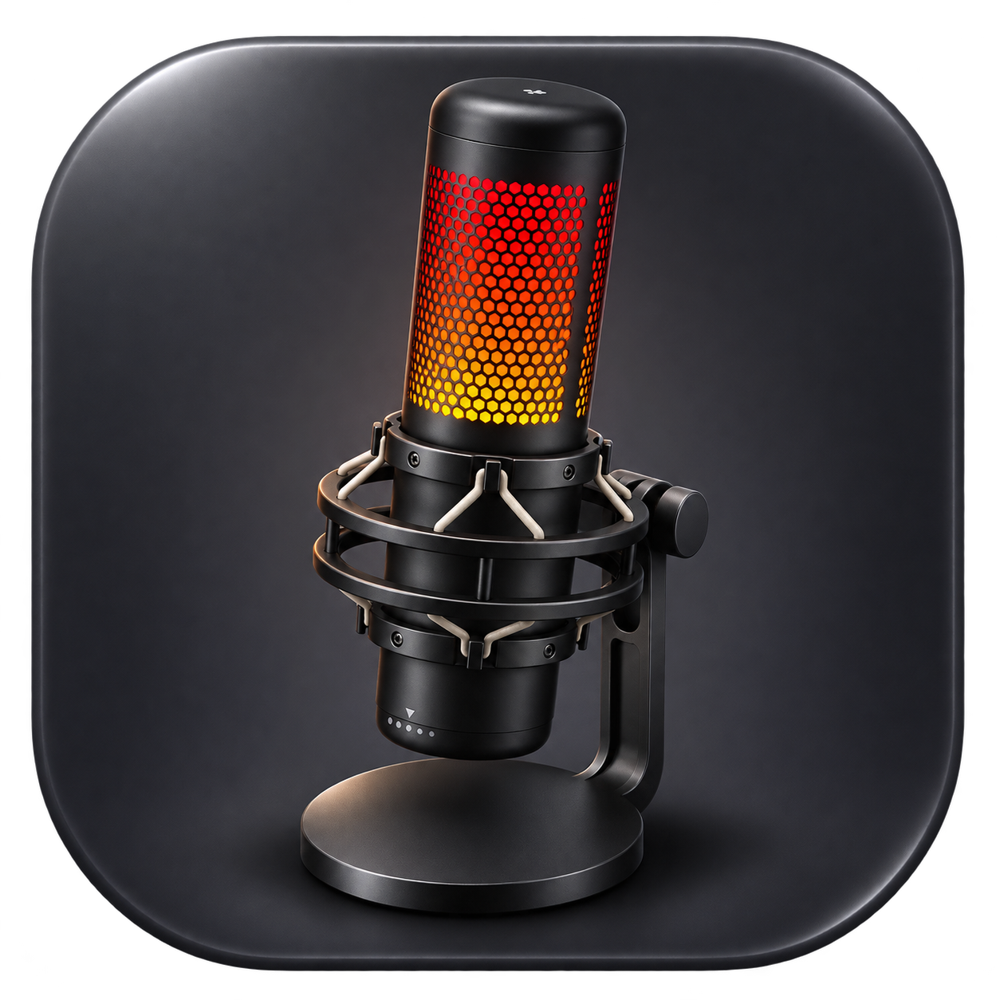

# HyperX Colors for macOS

[Português](#português) · [English](#english) · [Download](https://github.com/filipe-vieiras/hyperx-colors-macos/releases/latest)

A small, unofficial macOS menu-bar app for controlling **HyperX QuadCast S** lighting.



## Português

Um app gratuito e de código aberto para quem usa o QuadCast S no Mac e quer personalizar a iluminação.

### Recursos

- Cor fixa com seletor de cores e ajuste de brilho.
- Efeitos de pulsar, piscar e arco-íris com controle de velocidade.
- Botão para apagar a luz.
- Restaurar iluminação: recria um ciclo arco-íris. **Não é uma restauração de firmware**; a velocidade exata de fábrica não foi confirmada.
- Reaplica a última iluminação confirmada após repouso e tenta reconectar se o USB ainda não estiver disponível.
- Funciona pela barra de menus, sem ocupar o Dock; fechar a janela mantém o controle ativo.
- Opção **Launch at login**, com reaplicação da última iluminação escolhida.
- Preferências locais; sem conta, anúncios, telemetria ou conexão de rede pelo app.

### Baixar e usar

1. Baixe o ZIP em [Releases](https://github.com/filipe-vieiras/hyperx-colors-macos/releases/latest).
2. Descompacte e mova **HyperX Colors.app** para **Aplicativos** antes de ativar o início automático.
3. Encerre qualquer versão antiga pelo menu **Quit** na barra de menus.
4. Conecte seu QuadCast S e abra o app.
5. Escolha o efeito, a cor, o brilho e a velocidade e clique em **Apply**.
6. Feche a janela ou clique em **Hide**. Para reabrir ou sair, use o ícone de microfone na barra de menus.

O pacote público inicial é para **Apple Silicon (M1 ou posterior), macOS 13+**. Compilar em Intel deve gerar um app nativo para Intel, mas essa configuração não foi testada.

O app tem assinatura local (*ad hoc*), **sem Developer ID ou notarização da Apple**. O macOS pode impedir sua abertura. Se confiar no projeto, consulte as [instruções oficiais da Apple](https://support.apple.com/102445) ou compile a partir do código. Não é necessário desativar o Gatekeeper.

### Iniciar com o Mac

Marque **Launch at login**. O macOS pode exigir aprovação nos seus Itens de Início; nesse caso, o app oferece um botão para abrir os ajustes. Desmarque para desativar. O início acontece ao entrar na sua conta, não antes do login.

Com essa opção ativada, o app reaplica a última configuração ao abrir. Se o microfone ainda não estiver conectado, conecte-o e clique em Aplicar. Após repouso, o app reabre a conexão USB e reaplica o último comando confirmado, tentando novamente a cada 3 segundos se o microfone estiver indisponível. Isso inclui luz apagada. Enquanto o app estiver rodando, também tenta recuperar o controle caso o processo USB seja interrompido. A janela de controles pode aparecer ao iniciar.

### Compatibilidade e estado

**Experimental.** Cor fixa confirmada por um usuário com QuadCast S e Mac M4. Pulsar/piscar/arco-íris têm testes de geração de comandos, mas ainda precisam de confirmação física. A opção de início automático foi compilada, mas ainda precisa de um teste real de logout/login. A recuperação após repouso passou em testes simulados; ainda precisa ser confirmada em um ciclo real de repouso.

Outros microfones HyperX não foram validados por este app, mesmo que o controlador original reconheça outros modelos. Não há garantia de persistência ao encerrar o app ou desconectar o microfone. Use apenas uma ferramenta de controle RGB por vez.

### Compilar

Requisitos: macOS 13+, Python 3 e ferramentas de linha de comando da Apple (ou Xcode).

```sh
xcode-select --install
python3 scripts/build.py
python3 scripts/test.py
```

O resultado fica em `dist/HyperX Colors.app`, junto do ZIP. O script compila a libusb a partir da fonte incluída, sem Homebrew ou downloads adicionais. As ferramentas da Apple podem precisar ser instaladas antes. O arquivo libusb é verificado por SHA-256.

### Contribuir

Abra uma issue com modelo/revisão do microfone, versão do macOS, chip do Mac, efeito usado e mensagem do app. Não envie números de série ou dados pessoais. Pull requests são bem-vindos. Leia [CONTRIBUTING.md](CONTRIBUTING.md).

### Créditos e licença

O controle USB usa [QuadcastRGB, de Ors1mer](https://github.com/Ors1mer/QuadcastRGB), e [libusb](https://libusb.info/). Este projeto disponibiliza sua interface e scripts sob **GPL-2.0-only**, com o código correspondente e os avisos preservados. Veja [LICENSE](LICENSE) e [THIRD_PARTY.md](THIRD_PARTY.md).

Projeto comunitário independente, sem afiliação ou endosso de HyperX ou HP. HyperX e QuadCast são marcas de seus respectivos titulares.

## English

Free, open-source, unofficial menu-bar lighting control for the **HyperX QuadCast S on macOS**.

### Features

Solid colors, brightness, pulse, blink and rainbow effects, animation speed, lights off, a recreated default-style rainbow, background operation, and optional launch at login with the last lighting configuration restored. Close the window to keep the app running; use the menu-bar microphone to reopen or quit.

### Install

Download the Apple Silicon ZIP from [Releases](https://github.com/filipe-vieiras/hyperx-colors-macos/releases/latest), extract it, move the app to **Applications**, quit older instances, connect your microphone and open the app. Choose a mode and click **Apply** (Apply). The interface is in English.

Requires **macOS 13+**. The initial binary targets **Apple Silicon**. Intel builds are untested. The app is ad-hoc signed and **not Apple-notarized**. If macOS blocks it, follow [Apple's official guidance](https://support.apple.com/102445) only if you trust this project, or build from source.

### Launch at login

Enable **Launch at login**. macOS may require approval in Login Items; a button appears when approval is pending. Disable the checkbox to unregister. Move the app to Applications before enabling this feature. The app restores the last configuration on launch when enabled, including lights off. The controls window may appear at login.

Wake recovery reopens the USB connection and restores the last applied command, including lights off. If the helper exits while the microphone is unavailable, the app retries every 3 seconds until it can reconnect. The app must remain running. Unapplied window edits are not used for recovery.

### Status and build

Experimental: solid-color control was physically confirmed on a QuadCast S with an M4 Mac. Animated effects have command-generation tests across 1,200 mode/speed/brightness combinations, but still need hardware confirmation. Launch-at-login compiles successfully but still needs a real logout/login test. Wake recovery has automated simulated lifecycle tests, but still needs a real hardware sleep/wake check. Other microphone models are not validated. Settings may not persist after quitting or unplugging.

Build on macOS with Python 3 and Apple command-line tools:

```sh
python3 scripts/build.py
python3 scripts/test.py
```

Output: `dist/HyperX Colors.app` and a ZIP. libusb source is bundled and checksum-verified; no Homebrew or dependency downloads are required by the build script.

### License and attribution

GPL-2.0-only for the interface and scripts. USB controller: [Ors1mer/QuadcastRGB](https://github.com/Ors1mer/QuadcastRGB), GPL-2.0-only. libusb 1.0.29: LGPL-2.1-or-later, dynamically linked, with complete source provided. See [THIRD_PARTY.md](THIRD_PARTY.md).

Unofficial community project. Not affiliated with or endorsed by HyperX or HP. Trademark rights are not granted by this project's license.
